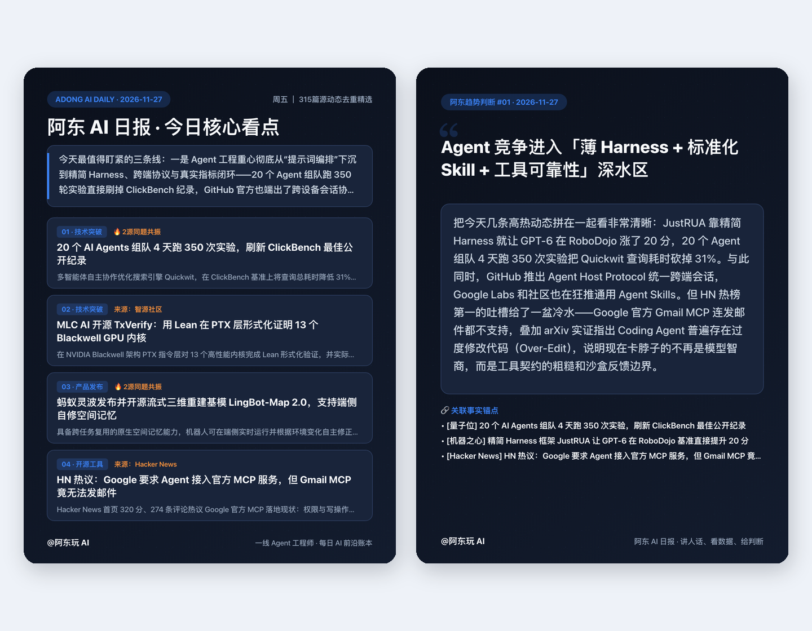
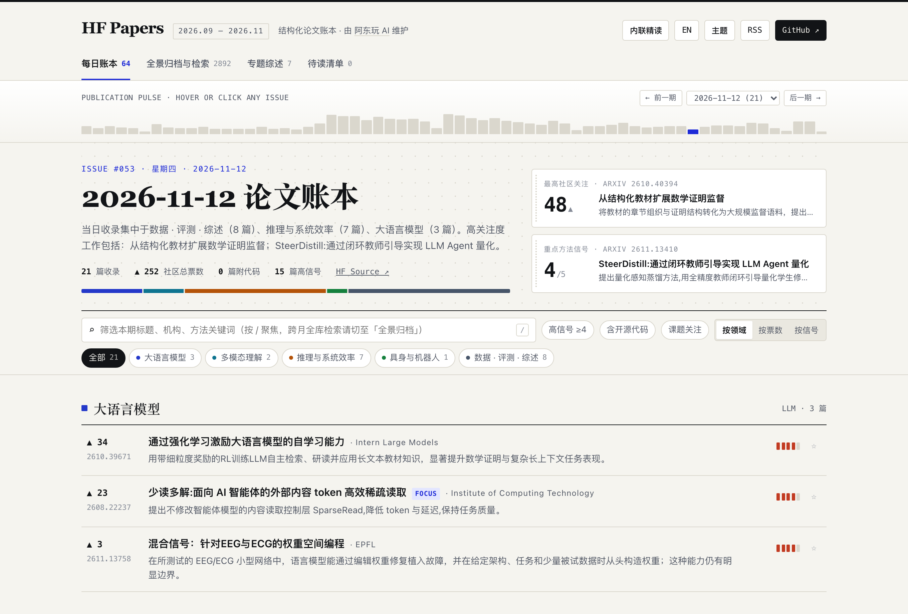
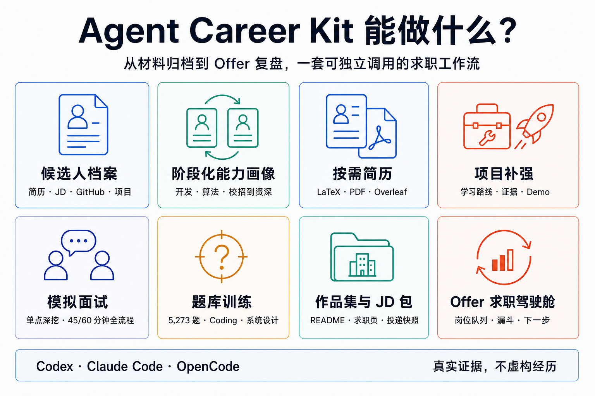

# adong-skills

这里放的是我自己每天在 Claude Code、Codex 和 Antigravity 里实际在用的 11 个 Skills。

先交代下背景：我白天做大模型和 Agent，下班还要看论文、写公众号和小红书、偶尔帮朋友改简历看面试。事情一多，很多重复活儿就想交给 Agent 干；但直接写两句 Prompt 跑出来的东西，十有八九带着一股 AI 味，链接还经常瞎编。

所以我干脆把平时跑顺了的几套流程——怎么抓一手信源去重、怎么卡住格式不让模型胡编链接、怎么按掉论文和文章里的套话——写成脚本和参考样本，封成了这几个独立目录。你看上哪个直接拆哪个去用就行。

> 顺手宣传一下我维护的另一份笔记：如果你在看 AI Agent 工程实践或者准备相关面试，可以配合翻翻 [AgentGuide](https://github.com/adongwanai/AgentGuide)。

---

## 里面都有啥（按我平时怎么用分四类）

### 1. 早起刷信息、看论文

- **[`adong-ai-daily`](./adong-ai-daily/)**：每天早起扫全网动态用的。脚本直接去抓 X 上的建设者推文、播客、GitHub Trending、HN、HF/arXiv 和 9 家中文 AI 媒体，把撞车的同一件事合并去重，最后只吐出两个文件：一个能筛选搜索、能顺手导出小红书卡片的**单文件 HTML 日报**，再加一份**直接复制就能发微信群的纯文本早报**（线上自动更新站：[adong-ai-daily](https://adongwanai.github.io/adong-ai-daily/)）。不用配任何 API Key，Python 标准库就能跑。
- **[`adong-daily-paper`](./adong-daily-paper/)**：专门用来啃 Hugging Face 每日论文。把每篇到底解决什么问题、怎么做的、实验数字多少抠出来存成 Markdown，同时增量编译一个带全文搜索的静态网页（我自己跑的线上站：[hf-daily-papers](https://adongwanai.github.io/hf-daily-papers/)）。

### 2. 改顶会论文、打数据竞赛、做技术取舍

- **[`vibe-paper-deai`](./vibe-paper-deai/)**：投 NeurIPS / ICML / ACL 前自查用的。先站在 Area Chair 视角挑出初稿里虚张声势的 Claim 和敷衍的消融分析，再在不改任何实验事实的前提下，把那种大模型味儿很重的英文改回正常学者的写法。
- **[`kaggle-prior-art`](./kaggle-prior-art/)**：打 Kaggle / DrivenData / 天池前摸底用的。免配 Token 秒查 700+ 场往届相似比赛的金牌方案帖与代码，遇到跨界新赛题自动拆成「同模态借架构 + 同指标借 Loss 与后处理」双路拼图，顺带跑一遍 GitHub 代码体检把 404 链接和 `"Code coming soon"` 空壳仓库筛掉，最后给出一份带采用率占比的共识底座和开局前 48 小时 EDA 验证单。
- **[`andrej-karpathy-perspective`](./andrej-karpathy-perspective/)**：攒了 Karpathy 历年的演讲、博客和访谈原话。设计 Agent 交互边界、或者纠结系统是不是做重了的时候，拿来做个对照很管用。
- **[`github-to-skill`](./github-to-skill/)**：刷到好用的开源项目或 CLI，让它自己翻完仓库结构，给你起好一份能直接改改就用的 `SKILL.md` 骨架。

### 3. 写公众号、小红书、发 X

- **[`adong-wechat-writer`](./adong-wechat-writer/)** / **[`adong-xhs-writer`](./adong-xhs-writer/)** / **[`adong-x-writer`](./adong-x-writer/)**：我自己写公众号长文、小红书图文卡片和 X Thread 用的三套底子。核心规矩就一条：先聊自己亲手试过什么、数字是多少，把“总而言之、意义重大”这类正确的废话全按掉。说实话，它们能帮你省掉大半搭骨架的时间，但最后那 20% 的个人经历和判断，还是得你自己填。

### 4. 入门选型、改简历、练面试

- **[`agent-resource-scout`](./agent-resource-scout/)**：给刚学 Agent 的朋友和做开源框架选型时排雷用的。问怎么入门，它按「原生 API 手写最小闭环 → 官方系统课 → 框架实战」只给 3 步路线和前 30 分钟开跑动作，顺带告诉你怎么把玩具 Demo 改造成能写进简历、扛住面试追问的真项目；问技术选型，拉 3–5 个候选比活跃度、Issue 响应、PyPI/npm 近 30 天真实下载量和商用协议风险。内置两个纯标准库核验脚本，输出前把 404 幻觉仓库、刷星壳子和 CSDN / 扫码进群引流帖全筛一遍。
- **[`agent-career-kit`](./agent-career-kit/)**：面向校招和社招 Agent 岗（开发和算法两个方向）。把你手头的旧简历、项目文档导进去建个事实库，按目标 JD 出 Overleaf / PDF 简历、跑 45 分钟追问式模拟面试、顺带生成个人作品集网页。底线是不替你编经历、不造假指标。

---

## 怎么装

### 方式一：用 `skills` CLI 挑着装（推荐）

```bash
# 想装哪个把后面的名字换掉就行
npx skills add adongwanai/adong-skills --skill adong-ai-daily -g
npx skills add adongwanai/adong-skills --skill adong-daily-paper -g
npx skills add adongwanai/adong-skills --skill kaggle-prior-art -g
npx skills add adongwanai/adong-skills --skill agent-resource-scout -g
npx skills add adongwanai/adong-skills --skill vibe-paper-deai -g
npx skills add adongwanai/adong-skills --skill agent-career-kit -g

# 看仓库里全部能装的列表
npx skills add adongwanai/adong-skills --list
```

### 方式二：Clone 下来自己建软链（方便随时 `git pull` 更新）

```bash
git clone https://github.com/adongwanai/adong-skills.git
cd adong-skills

# Claude Code
ln -sfn "$(pwd)/adong-ai-daily" ~/.claude/skills/adong-ai-daily

# OpenAI Codex
ln -sfn "$(pwd)/adong-ai-daily" ~/.codex/skills/adong-ai-daily

# Antigravity / Gemini CLI
ln -sfn "$(pwd)/adong-ai-daily" ~/.gemini/config/skills/adong-ai-daily
```

装好之后不用记复杂参数，直接在聊天框里跟 Agent 说人话就行——比如“跑一份今天的 AI 日报”、“按 AC 视角审一下这篇论文初稿”、“把这篇论文按我的风格写篇公众号”。

---

## 实际跑出来的样子

### 1. `adong-ai-daily`（每日多源 AI 情报账本 + 卡片导出）

左边是生成的本地单文件 HTML（支持按分类和信源过滤，点判断里的 `[N005]` 角标能直接跳到对应新闻）；右边是页面内置卡片工作台直出的小红书封面卡和观点卡，离线就能下高清 PNG：

| 单文件交互式 HTML 日报 | 页面内置导出的分享卡片 |
| :---: | :---: |
|  |  |

---

### 2. `adong-daily-paper`（HF 每日论文账本与检索站）

线上每天在跑的实例：[https://adongwanai.github.io/hf-daily-papers/](https://adongwanai.github.io/hf-daily-papers/)（站点源码在 [hf-daily-papers](https://github.com/adongwanai/hf-daily-papers)）。每次跑完一边存干净的 `daily/YYYY-MM-DD.md`，一边更新静态站和 RSS：

| 每日论文账本页 | 月度热力日历与跨月检索 |
| :---: | :---: |
|  |  |

---

### 3. `agent-career-kit`（Agent 岗简历、模拟面试与作品集）

详细用法见 [agent-career-kit/README.md](./agent-career-kit/README.md)。下面是整套流程和用公开虚构样例跑出来的简历/作品集效果：


<details>
<summary>展开看架构图和简历 / 作品集样例截图</summary>
<br/>



样例文件：[Agent 开发简历 PDF](./showcase/agent-career-kit/resumes/development/main.pdf) · [Agent 算法简历 PDF](./showcase/agent-career-kit/resumes/algorithm/main.pdf) · [个人作品集网页源码](./showcase/agent-career-kit/portfolio/index.html)

| Agent 开发方向简历 | Agent 算法方向简历 |
| :---: | :---: |
|  |  |

| 动态作品集（桌面端） | 项目详情页（移动端） |
| :---: | :---: |
|  |  |

</details>

---

## 关于我

我是 **阿东（Adong）**，平时主要折腾 AI Agent、RSI（递归自我改进）、Vibe Coding 和工程落地：

- **AI Agent 学习与面试指南**：[adongwanai/AgentGuide](https://github.com/adongwanai/AgentGuide)
- **HF 每日论文账本站**：[adongwanai.github.io/hf-daily-papers](https://adongwanai.github.io/hf-daily-papers/)
- **Follow RSI 实证追踪库**：[adongwanai.github.io/follow-rsi](https://adongwanai.github.io/follow-rsi/)
- **个人主页**：[adongwanai.github.io](https://adongwanai.github.io/)
- **小红书 / 微信公众号**：全网同名 **阿东玩AI**（私信「社群」可以进技术与求职交流群）

如果里面哪个 Skill 刚好帮上了忙，欢迎点个 **Star**。用的时候踩到坑直接提 Issue 就行。

## License

原创代码与文档采用 [MIT License](./LICENSE)。第三方材料按原许可证分发；`agent-career-kit` 相关模板来源见 [THIRD_PARTY_NOTICES.md](./agent-career-kit/THIRD_PARTY_NOTICES.md)，公开演示样例归属说明见 [showcase/agent-career-kit/README.md](./showcase/agent-career-kit/README.md)。
