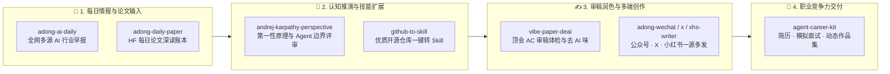
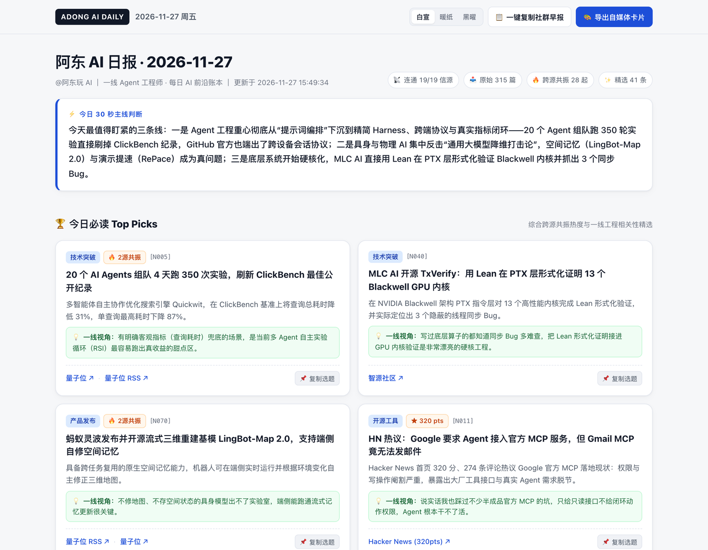
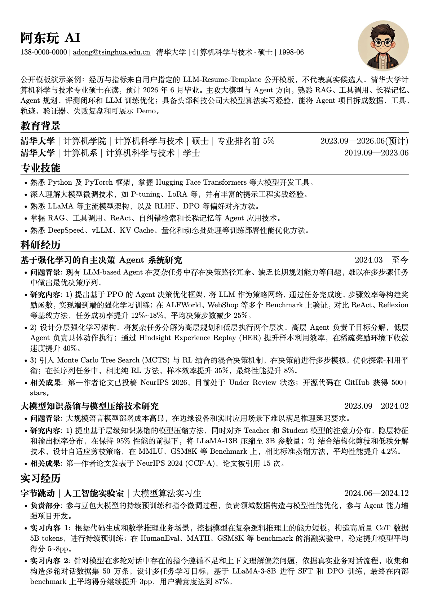
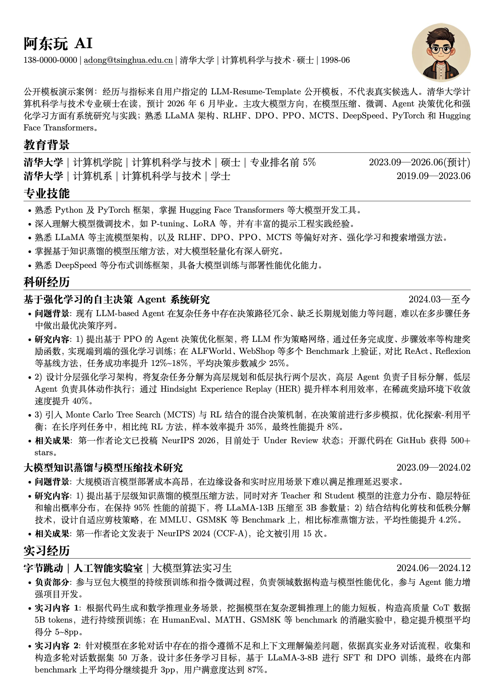
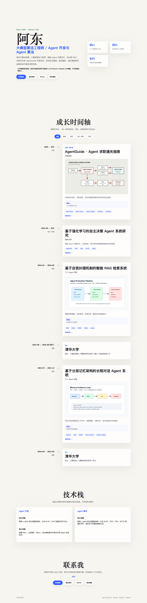
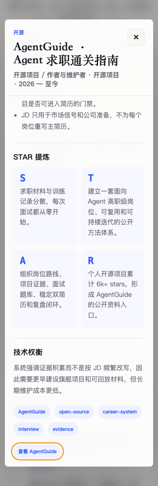

<div align="center">

# ⚡ adong-skills

**一线 Agent 工程师实战打磨的 9 款自包含中文 Agent Skills**  
拒绝空洞提示词与公关套话 · 用确定性脚本、真实语料与审校门禁搭起个人 AI 工作流闭环

[](#catalog)
[](#install)
[](#showcase)
[](./LICENSE)

[**30 秒看懂全景**](#overview) · [**按需选装表**](#catalog) · [**10 秒安装**](#install) · [**旗舰效果实拍**](#showcase) · [**配套 AgentGuide ↗**](https://github.com/adongwanai/AgentGuide)

</div>

---

<a id="overview"></a>
## 🧭 30 秒看懂整套工作流闭环

仓库里的 9 个 Skill 不是零散堆砌，而是围绕 **「前沿输入 → 工程思考 → 内容/学术输出 → 求职沉淀」** 串成的完整飞轮，每个模块均可**独立拆走即插即用**：



---

<a id="catalog"></a>
## 🎯 按场景选装（9 个自包含 Skill）

不知道先装哪个？对照下表看 **「你在聊天框直接说什么」** 与 **「最终拿到什么文件」**：

| 阶段 | Skill 目录 | 解决什么问题 | 装好后直接对 Agent 说（触发示例） | 外部依赖 | 最终交付产物 |
| :--- | :--- | :--- | :--- | :--- | :--- |
| **📡 情报输入** | **[`adong-ai-daily`](./adong-ai-daily/)** `NEW` | 聚合 X 建设者、播客、GitHub/HN、HF/arXiv 与 9 大中文媒体，并查集跨源去重 | `生成今天的AI日报` / `做一份社群转发的AI早报` | **零 Key · 纯标准库** | 交互式单文件 `.html`（含分享卡片导出台）+ 微信群一键转发 `.txt` |
| **📡 论文输入** | **[`adong-daily-paper`](./adong-daily-paper/)** | Hugging Face 每日论文抓取、去套话提炼方法与指标、构建静态检索站 | `跑一份 HF 今日论文` / `更新论文站` | 免 Key 交互或配 LLM Key | `daily/*.md` + 零构建静态学术账本站（[线上实例 ↗](https://adongwanai.github.io/hf-daily-papers/)） |
| **🔬 学术润色** | **[`vibe-paper-deai`](./vibe-paper-deai/)** | 顶会 Area Chair 视角审稿挑刺，清除论文里的 LLM 拔高套话与模板味 | `按 AC 视角审一下这篇初稿` / `把这段改得像人写的学术英文` | 纯规则与参考库 | `Mode A` 审稿诊断清单 / `Mode B` 保真去 AI 味重写 |
| **💼 求职闭环** | **[`agent-career-kit`](./agent-career-kit/)** | 校招 / 社招 Agent 开发与算法双方向求职系统，事实库严格防编造 | `导入我的简历准备字节 Agent 岗` / `来一场 45 分钟深挖模拟面试` | Python + 可选 LaTeX | 定向 PDF/Overleaf 简历、证据审计表、模拟面试复盘、个人作品集网页 |
| **🧠 工程认知** | **[`andrej-karpathy-perspective`](./andrej-karpathy-perspective/)** | 引入 Karpathy 的 Software 2.0/3.0 与 Agent Loop 框架做技术取舍与学习规划 | `用 Karpathy 视角评审这套 Agent 架构` | 内置一手语料库 | 架构边界拆解、最小实现路线、技术选型判断 |
| **🛠️ 技能工厂** | **[`github-to-skill`](./github-to-skill/)** | 搜索评估 GitHub 仓库质量，将好用的 CLI / 工具库封装为标准 Skill | `把这个 GitHub 仓库封装成 Skill` | Python 标准库 | 仓库可用性评估 + 标准自包含 `SKILL.md` 目录骨架 |
| **✍️ 深度长文** | **[`adong-wechat-writer`](./adong-wechat-writer/)** | 一线工程师口吻撰写微信公众号深度技术长文（选题质检 → 成稿 → 去套话） | `把这篇论文/项目按阿东风格写成公众号长文` | 纯规范驱动 | 逻辑硬核、讲人话的公众号技术长文 |
| **✍️ 海外短推** | **[`adong-x-writer`](./adong-x-writer/)** | 提炼核心技术判断，生成高信息密度单条推文或 X / Twitter Thread | `把这篇稿子拆成 X thread` | 纯规范驱动 | 高密度推文 / 结构化长推串 |
| **✍️ 图文卡片** | **[`adong-xhs-writer`](./adong-xhs-writer/)** | 产出小红书 300–800 字技术干货笔记与 6–9 页图文卡片分镜方案 | `把这次踩坑写成小红书图文笔记` | 纯规范驱动 | 小红书外层短文案 + 逐页卡片排版脚本 |

> [!TIP]
> **两款“每日情报” Skill 怎么选？**
> - 想每天 **5 分钟扫完全网动态**（大佬推文、开源热榜、产业重磅）并直接**一键转发微信群 / 导出小红书分享图** 👉 用 **[`adong-ai-daily`](./adong-ai-daily/)**。
> - 想**逐篇深挖每日最新论文**的问题边界、核心机制、定量对比并沉淀**可检索学术网站** 👉 用 **[`adong-daily-paper`](./adong-daily-paper/)**。两者互补，可同时安装。

---

<a id="install"></a>
## ⚡ 10 秒快速安装

### 方式一：使用 `skills` CLI 一键按需安装（最省心）

```bash
# 📡 情报与科研组合包
npx skills add adongwanai/adong-skills --skill adong-ai-daily -g
npx skills add adongwanai/adong-skills --skill adong-daily-paper -g
npx skills add adongwanai/adong-skills --skill vibe-paper-deai -g

# ✍️ 多平台技术写作组合包
npx skills add adongwanai/adong-skills --skill adong-wechat-writer -g
npx skills add adongwanai/adong-skills --skill adong-xhs-writer -g
npx skills add adongwanai/adong-skills --skill adong-x-writer -g

# 💼 Agent 求职冲刺与工程认知包
npx skills add adongwanai/adong-skills --skill agent-career-kit -g
npx skills add adongwanai/adong-skills --skill andrej-karpathy-perspective -g

# 查看仓库全部可用模块列表
npx skills add adongwanai/adong-skills --list
```

### 方式二：Git 克隆并软链到常用客户端（方便随时 `git pull` 升级）

```bash
git clone https://github.com/adongwanai/adong-skills.git
cd adong-skills

# 按你使用的客户端任选一行软链（将 adong-ai-daily 替换为任意模块名，或用 for 循环全量挂载）：
ln -sfn "$(pwd)/adong-ai-daily" ~/.claude/skills/adong-ai-daily          # Claude Code
ln -sfn "$(pwd)/adong-ai-daily" ~/.codex/skills/adong-ai-daily           # OpenAI Codex
ln -sfn "$(pwd)/adong-ai-daily" ~/.gemini/config/skills/adong-ai-daily   # Antigravity / Gemini CLI
```

---

<a id="showcase"></a>
## 📸 核心旗舰模块实拍

### 1. [`adong-ai-daily`](./adong-ai-daily/) — 多源 AI 行业日报与自媒体分享卡片工作台

免登录、零 API Key、纯 Python 标准库直连 **19 个公开一手与科技信源**（`follow-builders` X 建设者与播客、HF Daily Papers、arXiv `cs.AI`、OpenAI News、GitHub Trending、Hacker News 及 9 大中文 AI 媒体）：

- **并查集跨源共振去重**：自动将多家媒体同题报道聚合成单一事件簇（标注 `🔥 N源共振`），配合关注方向三维加权打分过滤噪音。
- **短 ID 防幻觉回填**：大模型只做去震惊体事实提炼与跨事件趋势判断，真实多源 URL 与 Star/点赞热度由渲染脚本按 `N001` 精确回填，杜绝编造链接。
- **极简双端交付 + 零依赖卡片导出**：只输出 1 份**自包含交互式 HTML 账本页**（支持白宣/暖纸/黑曜三主题、证据角标平滑定位、一键提取写作选题、内置 HTML5 Canvas 高清分享卡导出）与 1 份**微信群/飞书群一键转发纯文本早报**。

| 自包含交互式 HTML 日报账本（含前置判断与多维筛选） | 内置本地高清分享卡片工作台（小红书封面卡 & 趋势金句卡） |
| :---: | :---: |
|  |  |

---

### 2. [`adong-daily-paper`](./adong-daily-paper/) — HF 每日论文账本与静态学术站

- **线上运行实例**：[https://adongwanai.github.io/hf-daily-papers/](https://adongwanai.github.io/hf-daily-papers/)（独立站点仓库 [hf-daily-papers](https://github.com/adongwanai/hf-daily-papers)）
- **双产物同步归档**：每次运行同步生成结构化 `daily/YYYY-MM-DD.md`（适配 Obsidian / 飞书知识库）与零构建交互网页 `site/`（含 Atom RSS 订阅与跨月全文秒级检索）。
- **克制求真的文献精读**：严格基于原文汇报痛点、机制与定量指标；仅对高启发度工作（`≥4/5`）展开可验证后续实验设想，支持快捷键 `/` 检索、`J/K` 翻篇与一键复制 BibTeX。

| 每日论文账本视图（含脉冲时间轴与领域谱系） | 月度热力日历与跨期全库检索 |
| :---: | :---: |
|  |  |

---

### 3. [`agent-career-kit`](./agent-career-kit/) — AI Agent 开发 / 算法全流程求职系统

- **完整说明文档**：[agent-career-kit/README.md](./agent-career-kit/README.md)
- **证据驱动，绝不注水**：支持从 PDF / DOCX / Markdown / LaTeX 导入已有经历，候选人主事实库与单岗位 JD 投递包严格分离，每一条简历 Bullet 均绑定证据等级审计。
- **全链路求职交付**：一键编译 `Agent 开发` / `Agent 算法` 双方向标准 LaTeX 简历、45/60 分钟压力追问模拟面试、Story Bank 故事库与响应式个人作品集网站。


<details>
<summary><b>点击展开查看 Agent Career Kit 系统架构图与简历 / 作品集实拍</b></summary>
<br/>


公开模板演示产物（基于公开虚构样例生成）：
[Agent 开发版简历 PDF](./showcase/agent-career-kit/resumes/development/main.pdf) · [Agent 算法版简历 PDF](./showcase/agent-career-kit/resumes/algorithm/main.pdf) · [动态作品集源码](./showcase/agent-career-kit/portfolio/index.html)

| Agent 开发方向简历 | Agent 算法方向简历 |
| :---: | :---: |
|  |  |

| 动态求职作品集（桌面端） | 项目证据详情（移动端） |
| :---: | :---: |
|  |  |

</details>

---

### 4. 审稿去 AI 味、认知评审与多平台创作模块

| 模块 | 核心设计亮点 |
| :--- | :--- |
| **[`vibe-paper-deai`](./vibe-paper-deai/)** | 内置顶会审稿高频红旗词库与重写管线：`Mode A` 从 Area Chair 视角定位浮夸 Claim、空洞消融与伪形式化公式；`Mode B` 在零事实篡改前提下还原扎实自然的人类学术笔触。 |
| **[`adong-wechat-writer`](./adong-wechat-writer/)**<br>**[`adong-x-writer`](./adong-x-writer/)**<br>**[`adong-xhs-writer`](./adong-xhs-writer/)** | 共享「先做再说、讲人话、先结论后解释、敢下明确工程判断」底层文风规范：同一份技术调研或源码实战，可分别按公众号深度叙事、X 高密度 Thread、小红书分页图文卡片精准变形。 |
| **[`andrej-karpathy-perspective`](./andrej-karpathy-perspective/)** | 系统沉淀 Karpathy 历年演讲、博客、访谈一手语料与决策时间线，适合在做复杂 Agent 系统减法、规划从零手搓（From-Scratch）学习路径时做第一性原理对齐。 |
| **[`github-to-skill`](./github-to-skill/)** | 自动抓取 GitHub 仓库元数据、活跃度与 README 结构，快速生成遵循渐进式披露（Progressive Disclosure）原则的自包含 Skill 包。 |

---

## 📂 仓库统一目录规范

每个子目录都是一个无外部路径硬编码的独立 Skill，支持单目录拷走或 Fork 二次定制：

```text
<skill-name>/
├── SKILL.md          # 必需：触发条件（YAML Frontmatter）与精简执行规程
├── config.json       # 可选：默认参数与关注方向配置（支持本地 config.local.json 覆盖）
├── prompts/          # 可选：子任务结构化提示词模板
├── references/       # 可选：分类边界、去套话红线、领域语料（按需读取节省上下文）
├── scripts/          # 可选：确定性并发抓取、Schema 校验与多端渲染脚本
└── templates/        # 可选：静态网页或排版模板
```

---

## 👋 关于作者与开源生态

我是 **阿东（Adong）**，大厂 Agent 技术专家 / 大模型算法工程师 / OPC 实践者，持续开源分享一线可复现的 Agent 工程方法论：

- 📘 **AI Agent 学习与面试实战宝典**：[adongwanai/AgentGuide](https://github.com/adongwanai/AgentGuide)
- 📑 **HF 每日论文账本线上站**：[adongwanai.github.io/hf-daily-papers](https://adongwanai.github.io/hf-daily-papers/)
- 🔄 **Follow RSI（递归自我改进）追踪库**：[adongwanai.github.io/follow-rsi](https://adongwanai.github.io/follow-rsi/)
- 🌐 **个人主页**：[adongwanai.github.io](https://adongwanai.github.io/)
- 💬 **小红书 / 微信公众号**：全网同名 **阿东玩AI**（私信「社群」可加入技术与求职交流群）

如果这些 Skills 帮你在日常科研、写稿或求职里省下了时间，欢迎点一颗 **⭐ Star** 支持后续更新！

## License

仓库原创代码与文档采用 [MIT License](./LICENSE)。第三方材料按各自许可证分发；`agent-career-kit` 模板来源说明见 [THIRD_PARTY_NOTICES.md](./agent-career-kit/THIRD_PARTY_NOTICES.md)，公开演示样例归属说明见 [showcase/agent-career-kit/README.md](./showcase/agent-career-kit/README.md)。
