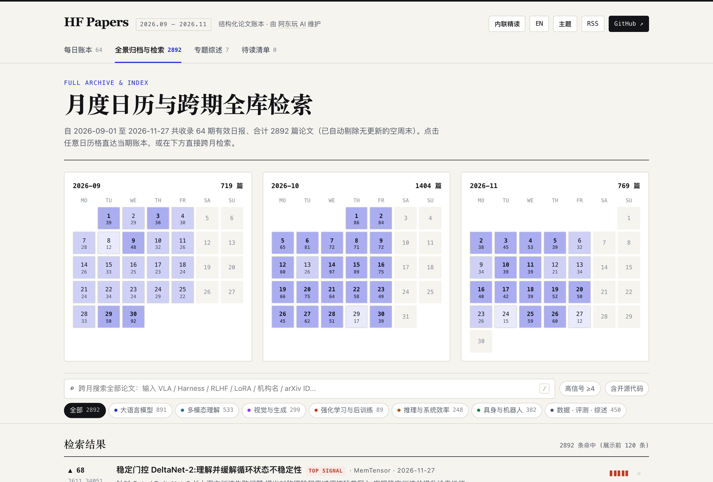
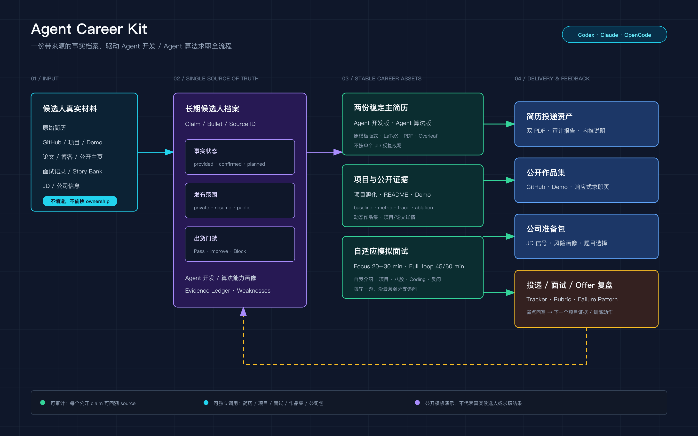

# adong-skills · 阿东的实战 Agent Skills 库

面向 **Claude Code / Codex / OpenCode / Cursor / Antigravity** 的自包含中文 Skills 集合。

这里收录的不是零散提示词，而是经过日常高频打磨、带确定性脚本、参考语料或审校门禁的 **可复用工作流模块**——覆盖 **前沿论文追踪与审稿去 AI 味**、**AI Agent 全流程求职系统**、**多平台技术内容创作** 三大核心场景。

> 觉得有用欢迎点个 **Star**。关于 AI Agent 工程、项目实战与面试题库，可同步搭配阅读 [AgentGuide](https://github.com/adongwanai/AgentGuide)。

---

## 技能速查总表（8 个自包含模块）

| 场景分类 | Skill 目录 | 一句话定位 | 核心产出 / 线上实例 |
| :--- | :--- | :--- | :--- |
| **科研与论文情报** | [`adong-daily-paper`](./adong-daily-paper/) | Hugging Face 每日论文抓取、去套话结构化精读与静态论文站引擎 | 双路输出 `daily/*.md` + 零构建交互账本站 · [线上实例 ↗](https://adongwanai.github.io/hf-daily-papers/) |
| **科研与论文情报** | [`vibe-paper-deai`](./vibe-paper-deai/) | 顶会 Area Chair 视角审稿诊断与学术论文去 AI 写作痕迹 | `Mode A` 审稿体检报告 / `Mode B` 保真学术润色 |
| **求职与工程成长** | [`agent-career-kit`](./agent-career-kit/) | 校招 / 社招 / 资深候选人的 Agent 开发与算法 Offer 求职系统 | 证据库审计、LaTeX/PDF 定向简历、模拟面试、动态求职页 |
| **求职与工程成长** | [`andrej-karpathy-perspective`](./andrej-karpathy-perspective/) | Andrej Karpathy 技术认知框架（Software 2.0/3.0、Agent Loop、学习与决策） | 架构评审、学习路径规划、第一性原理拆解 |
| **求职与工程成长** | [`github-to-skill`](./github-to-skill/) | 搜索评估优质开源仓库，快速封装为标准 Agent Skill | 仓库质量评估 + 结构化 `SKILL.md` 与脚本骨架 |
| **多平台技术写作** | [`adong-wechat-writer`](./adong-wechat-writer/) | 微信公众号深度技术长文全流程创作（选题深化 → 初稿 → 去 AI 味） | 结构清晰、有人味的公众号技术长文 |
| **多平台技术写作** | [`adong-x-writer`](./adong-x-writer/) | X / Twitter 单条推文与长推串（Thread）拆解创作 | 高信息密度推文 / 长文转 X Thread |
| **多平台技术写作** | [`adong-xhs-writer`](./adong-xhs-writer/) | 小红书技术干货图文笔记生成（300–800 字 + 分镜配图建议） | 小红书图文脚本与封面配图方案 |

---

## 10 秒快速安装

### 方式一：通过 `skills` CLI 按需安装（推荐）

```bash
# 安装单个 Skill（例如每日论文账本或论文去 AI 味）
npx skills add adongwanai/adong-skills --skill adong-daily-paper -g
npx skills add adongwanai/adong-skills --skill vibe-paper-deai -g

# 查看或安装仓库内其他 Skill
npx skills add adongwanai/adong-skills --list
```

### 方式二：克隆仓库并软链 / 复制到本地客户端

```bash
git clone https://github.com/adongwanai/adong-skills.git
cd adong-skills

# Claude Code
ln -s "$(pwd)/adong-daily-paper" ~/.claude/skills/adong-daily-paper

# OpenAI Codex
ln -s "$(pwd)/adong-daily-paper" ~/.codex/skills/adong-daily-paper

# Antigravity / Gemini CLI
ln -s "$(pwd)/adong-daily-paper" ~/.gemini/config/skills/adong-daily-paper

# 项目级通用 .agents 目录
mkdir -p /path/to/your-project/.agents/skills
cp -r adong-daily-paper /path/to/your-project/.agents/skills/
```

---

## 重点工程级 Skill 详解

### 1. `adong-daily-paper` — HF 每日论文账本与静态站生成器

- **源码目录**：[adong-daily-paper/](./adong-daily-paper/)
- **线上运行实例**：[https://adongwanai.github.io/hf-daily-papers/](https://adongwanai.github.io/hf-daily-papers/)（配套开源站仓库 [hf-daily-papers](https://github.com/adongwanai/hf-daily-papers)）

把每日 Hugging Face Papers 从“冗长摘要堆砌”改造成 **高密度学术账本 + Markdown 双路归档工作流**：

- **双产物同步生成**：每次运行同时产出带目录锚点的干净 `daily/YYYY-MM-DD.md`（方便同步飞书知识库 / Obsidian）与零构建静态网页 `site/`（含 Atom RSS 与跨月毫秒级全文检索）。
- **克制、去套话的文献提炼**：直读 HF `/api/daily_papers` 原生摘要、GitHub 仓库与星标；严格基于原文汇报问题、方法、定量结果，仅对高信号论文（`≥4/5`）展开可验证延伸实验设想。
- **双密度阅读与穿孔档案抽屉**：支持「紧凑账本速扫」与「三列内联精读」一键切换，支持键盘 `/` 搜索、`J/K` 翻篇与一键导出 BibTeX / Markdown。
- **支持双模式执行**：配好 API Key 可走并发脚本断点续跑；无外部 Key 时可由当前交互 Agent 分批提炼并自动入库编译网页。

| 每日论文账本视图（含脉冲时间轴与领域谱系） | 月度热力日历与跨期全库检索 |
| --- | --- |
|  |  |

---

### 2. `agent-career-kit` — AI Agent 开发 / 算法全流程求职系统

- **详细文档**：[agent-career-kit/README.md](./agent-career-kit/README.md)

面向校招、社招与资深候选人的证据驱动求职工作流。不要求预先整理复杂格式——从一份现有简历、一个目标 JD 或一个项目链接即可启动，覆盖：

- **多格式材料导入与事实库隔离**：支持 PDF / DOCX / Markdown / LaTeX 导入；长期候选人主档案与单岗位 JD 投递快照严格分离，绝不虚构经历、指标或真题。
- **双方向按需视图**：支持 `Agent 开发` 与 `Agent 算法` 单方向或双方向简历生成（保留标准 LaTeX / Overleaf 版式）及逐条 bullet 证据审计。
- **面试闭环与驾驶舱**：支持单项目 `focus` 深挖、45/60 分钟 `full-loop` 模拟面试、Story Bank 沉淀、动态个人求职作品集与中文求职转化漏斗看板。



<details>
<summary>展开查看 Agent Career Kit 架构图与公开模板演示截图</summary>


公开模板演示产物（基于公开 fixture 生成，仅展示排版与工程效果）：
- [Agent 开发版简历 PDF](./showcase/agent-career-kit/resumes/development/main.pdf) · [Agent 算法版简历 PDF](./showcase/agent-career-kit/resumes/algorithm/main.pdf) · [动态作品集源码](./showcase/agent-career-kit/portfolio/index.html)

| Agent 开发简历演示 | Agent 算法简历演示 |
| --- | --- |
|  |  |

| 动态求职页桌面端 | 移动端项目详情 |
| --- | --- |
|  |  |

</details>

---

## 其他核心模块一览

### 3. [`vibe-paper-deai`](./vibe-paper-deai/) — 顶会论文审稿体检与去 AI 味
- **适用场景**：NeurIPS / ICML / ICLR / ACL / CVPR 投稿前自检，识别并消除 LLM 写作痕迹（过度拔高声称、模板化 Limitation、浅层消融描述、碎片化公式与可疑引用）。
- **双模式**：`Mode A (Audit)` 输出 AC 视角审稿诊断与修改优先级；`Mode B (Rewrite)` 在严格保持技术事实不变的前提下重写段落。

### 4. [`andrej-karpathy-perspective`](./andrej-karpathy-perspective/) — Karpathy 技术认知与决策视角
- **适用场景**：AI / LLM 学习路线规划、Software 2.0/3.0 范式推演、Human-in-the-loop 与 Agent Loop 交互边界设计、From-Scratch 最小实现拆解。
- **内置资料**：自带系统化整理的演讲、博客、访谈、表达特征（Expression DNA）与关键技术决策时间线（位于 `references/`）。

### 5. [`github-to-skill`](./github-to-skill/) — 开源仓库转 Agent Skill 工具
- **适用场景**：给定技术需求自动检索评估 GitHub 项目质量，或将任意高质量 CLI / 脚本仓库提炼封装为目录自包含的标准 `SKILL.md` 模块。

### 6. 多平台技术内容创作套件（公众号 / X / 小红书）

一套保持统一技术审美与真实个人表达、拒绝公关腔的多平台内容生产流水线，支持跨平台一源多发：

| Skill | 目标平台 | 核心工作流与规格 | 常用触发口令 |
| :--- | :--- | :--- | :--- |
| [`adong-wechat-writer`](./adong-wechat-writer/) | 微信公众号 | 素材研读（PDF/链接/口述）→ 选题深化 → 长文成稿 → 去 AI 味精修 | `写公众号`、`写技术长文`、`按这篇论文出篇稿子` |
| [`adong-x-writer`](./adong-x-writer/) | X / Twitter | 提炼核心技术判断，生成高密度单推或结构化 Thread 推文串 | `写推文`、`拆成 X thread`、`转 Twitter 版本` |
| [`adong-xhs-writer`](./adong-xhs-writer/) | 小红书 | 产出 300–800 字技术干货图文文案 + 逐页卡片视觉配图建议 | `写小红书笔记`、`转小红书图文版` |

---

## 目录组织规范

本仓库所有 Skill 均遵循自包含目录约定，方便单独复制或 Fork 扩展：

```text
<skill-name>/
├── SKILL.md          # 必需：触发条件（Frontmatter）与分步执行规程
├── prompts/          # 可选：结构化子任务提示词模板
├── references/       # 可选：分类标准、调研语料、风格规范（按需加载省上下文）
├── scripts/          # 可选：确定性抓取、校验、构建脚本
└── templates/        # 可选：前端或文档导出模板
```

---

## 关于作者

我是 **阿东（Adong）**，持续深耕并分享 AI Agent、RSI（递归自我改进）、Vibe Coding、Skills 工程与求职实战：

- **AI Agent 学习与面试指南**：[adongwanai/AgentGuide](https://github.com/adongwanai/AgentGuide)
- **HF 每日论文账本与综述站**：[adongwanai.github.io/hf-daily-papers](https://adongwanai.github.io/hf-daily-papers/)
- **Follow RSI 实证追踪库**：[adongwanai.github.io/follow-rsi](https://adongwanai.github.io/follow-rsi/)
- **个人主页**：[adongwanai.github.io](https://adongwanai.github.io/)
- **小红书 / 微信公众号**：搜索 **阿东玩AI**（私信「社群」可加入技术与求职交流群）

## License

仓库原创代码与内容采用 [MIT License](./LICENSE)。第三方材料按各自许可证分发；`agent-career-kit` 相关模板来源与修改说明见 [THIRD_PARTY_NOTICES.md](./agent-career-kit/THIRD_PARTY_NOTICES.md)，公开演示材料的 CC BY 4.0 归属说明见 [showcase/agent-career-kit/README.md](./showcase/agent-career-kit/README.md)。
